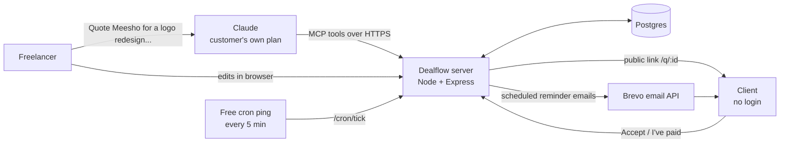

# Dealflow

**Tell Claude what you're charging. Dealflow gets you paid.**

Dealflow is the quote-to-cash back office for **freelancers**, and for the **small business owners** who sell the
same way. It runs on the customer's own Claude, with **no AI inside the app**.

A freelancer describes a job to Claude in a sentence. Claude writes the quote (scope, line items, terms, cover email)
and sends it to Dealflow over MCP. Dealflow emails it to the client, hosts it at a link the client can accept in one
click, turns the accepted quote into an invoice, and keeps sending polite follow-ups until the invoice is paid.

| | |
|---|---|
| Live app | https://dealflow-2vnc.onrender.com |
| Demo login | `demo@dealflow.app` / `demo1234` |
| MCP connector URL (demo account) | `https://dealflow-2vnc.onrender.com/mcp/demo-dealflow-7Qx2pLk9` (your own account's URL is on the **Connect Claude** page) |

## Documents

[Business strategy](docs/Dealflow_Strategy.pdf) · [Architecture & implementation notes](docs/Dealflow_Architecture.pdf) ·
[Unit economics model](docs/Dealflow_Economics.xlsx)

## Who it's for, and why freelancers first

**Primary: freelancers.** Designers, developers, writers, marketers and consultants who sell their own time.
**Secondary: small business owners**, such as studios, agencies and consultancies of 2–20 people, who quote and invoice
the same way at higher volume.

A freelancer is the whole company. The person doing the work is also the sales team, the finance team and the person
chasing payment, and their rent depends on it. The part of the job between "the client said yes on a call" and "the
money is in my account" is unpaid, awkward and easy to drop:

- **The market is large and growing.** India is widely estimated to have about 15 million freelancers, the
  second-largest freelance workforce after the US ([estimate, 2024](https://mediaindia.eu/?p=137926)). NITI Aayog
  projects India's gig workforce to grow from 7.7 million (2020–21) to 23.5 million by 2029–30
  ([NITI Aayog, 2022](https://www.niti.gov.in/sites/default/files/2022-06/Policy_Brief_India's_Booming_Gig_and_Platform_Economy_27062022.pdf)).
  In the US, 64 million people (38% of the workforce) freelanced in 2023
  ([Upwork Freelance Forward 2023](https://www.upwork.com/research/freelance-forward-2023-research-report)).
- **Getting paid is the core pain.** About 61% of Indian freelancers surveyed have gone unpaid at least once, and many
  are paid only 2–4 weeks after invoicing
  ([PayPal India freelancer survey, 2018, n=500](https://yourstory.com/2018/01/41pc-freelancers-witnessing-growth-2017-india-now-largest-freelancers-market-paypal-report)).
  In the US, 71% of freelancers have had trouble collecting payment, and 81% of those were paid late
  ([Freelancers Union](https://blog.freelancersunion.org/2015/12/10/costs-nonpayment/)).
  Across 100,000+ freelancers' invoices, 29% were paid after their due date
  ([Bonsai](https://www.hellobonsai.com/blog/late-freelance-payment)).
- **The admin eats billable time.** Freelancers report losing about 204 hours a year to admin and paperwork
  ([Smallpdf survey via ContentGrip](https://contentgrip.com/freelancer-admin-ai-gap)).
- **They already use AI.** Freelancers adopt new tools fast and many already pay for Claude. Dealflow turns that
  subscription into a working back office, with no second AI bill.
- **They're easy to reach, and they spread it.** Freelancers gather in communities and recommend tools to each other.
  Every quote they send puts Dealflow in front of a client, and those clients are often the small businesses we target next.

**Why this product:** Claude can already write an excellent quote, but it can't host it, see that the client opened
it, record their acceptance, or send a reminder next Tuesday after the chat has closed. Invoicing software can do those
things, but it makes the freelancer fill in forms. Dealflow joins the two: the customer's Claude does the thinking and
writing, and Dealflow does everything that has to keep happening after the chat ends.

## How it works



1. **Claude writes.** The freelancer asks Claude for a quote. Claude calls `create_quote` with the content it wrote,
   optionally including its own cover email and reminder emails.
2. **Dealflow sends it.** The quote is emailed to the client straight away and appears on the freelancer's dashboard,
   where every field can be edited. The client's link always shows the latest version.
3. **The client acts.** The client opens the link (tracked) and can accept with their name (recorded with a timestamp),
   ask for changes, or decline. Accepting turns the quote into invoice `INV-000N` with the freelancer's payment
   instructions. The client can then click **I've paid** with a payment reference and a screenshot.
4. **Dealflow follows up.** Standard follow-ups go out 3, 7 and 14 days after sending (configurable), or Claude's own
   reminder emails if it wrote them. They stop the moment the invoice is marked paid, the quote is declined or archived,
   or the client asks for changes.
5. **Claude reads it back.** "What's unpaid? Has Meesho opened it?" uses `list_quotes` / `get_quote`.

## MCP tools

| Tool | What it does |
|---|---|
| `get_business_profile` | Sender details, default currency, payment instructions, quote counts |
| `create_quote` | Create a quote from Claude's title, scope, line items, tax, discount, payment terms and T&Cs. **Automatically emails it to the client and schedules follow-ups** (3, 7, 14 days by default; Claude can write custom ones in the same call). Returns client and edit links |
| `list_quotes` | List quotes/invoices, filterable (`unpaid`, `accepted`, `paid`...), with open/accept status |
| `get_quote` | Full detail, reminders and activity log for one quote |
| `update_quote` | Change any field (items are replaced as a whole) |
| `send_quote` | Email the client the link (message optionally written by Claude) |
| `schedule_reminders` | Add Claude-written reminder emails at relative or absolute times. Supports `{{client_name}}`, `{{amount}}`, `{{number}}`, `{{due_date}}`, `{{link}}`, `{{sender_name}}` |
| `archive_quote` | Hide a quote from the main list (or restore it); pauses its reminders |
| `mark_paid` | Mark paid and cancel pending reminders |

Transport: Streamable HTTP, stateless (`POST /mcp/:key`). Each account has its own secret connector URL; the key
in the path identifies the account (no OAuth in v1).

## Connect it to Claude

1. Log in to Dealflow and open **Connect Claude**. Copy your connector URL.
2. In Claude (claude.ai or the desktop app): **Settings → Connectors → Add custom connector**. Name it
   `Dealflow`, paste the URL, leave OAuth fields empty, click **Add**.
3. In a new chat, make sure Dealflow is enabled in the tools menu, then ask:
   > Create a Dealflow quote for Anurag at Meesho (anurag@example.com): logo redesign with 3 concepts and 2 revision
   > rounds for ₹40,000, plus brand guidelines for ₹15,000. 18% GST, 50% upfront. Then schedule 3 reminders:
   > friendly in 3 days, follow-up in 7, firm in 14.

Claude Code: `claude mcp add --transport http dealflow <connector URL>`

## What we built vs. what is proposed

| Built and live in v1 | Simulated / manual in v1 | Proposed next |
|---|---|---|
| MCP server with 9 tools | **Payment** is not processed: the invoice shows the owner's payment instructions (UPI/bank) and the client clicks "I've paid"; the owner confirms | Razorpay/Stripe payment links with automatic "paid" on webhook |
| Owner dashboard: edit every field, line items, reminders, activity log | **Email** goes out only if a Brevo key is configured; otherwise reminders are recorded in the app as "recorded, email off" | WhatsApp reminders (very common in India) |
| Public client page: view tracking, accept with name + timestamp, decline with reason, "I've paid", print to PDF | The demo account's payment details are samples | OAuth for the MCP connector instead of a secret URL |
| Quote → invoice conversion with separate numbering | | Recurring retainers, multi-currency reporting, GST-compliant invoice PDF |
| Scheduled reminders that stop on payment/decline | | Team seats, client portal across all their invoices |

## Our app vs. partner responsibilities

| Dealflow (this repo) | Partners |
|---|---|
| Accounts, data storage, quote/invoice logic and numbering, editing UI, public client pages, view/accept/paid tracking, reminder scheduling and cancellation, MCP tool definitions | **Claude (Anthropic, paid by the customer's plan):** all writing and reasoning: scope, pricing structure, terms, reminder copy, summaries. **Render:** hosting + Postgres. **Brevo:** email delivery. **cron-job.org:** 5-minute wake-up ping. |

No AI provider keys exist anywhere in the code or config.

## Tech

Node 20+, Express 5, `@modelcontextprotocol/sdk` (Streamable HTTP), Postgres (`pg`), server-rendered HTML with a
little vanilla JS. No frontend framework and no build step.

```
src/server.js     routes: marketing, auth, owner app, public client pages, /mcp/:key, /cron/tick
src/mcp.js        MCP server and the 9 tools
src/quotes.js     domain logic: totals, numbering, status changes, reminders, template placeholders
src/reminders.js  scheduler and email delivery (Brevo API, or in-app log)
src/views.js      HTML pages
src/db.js         Postgres pool and schema (auto-migrates on boot)
src/auth.js       password hashing (scrypt), signed session cookies, demo account
```

Statuses: `draft → sent → viewed → (changes requested) → accepted (invoice, awaiting payment) → client marked paid → paid`, or `declined`. Quotes can also be archived.

Client page: accept with name, **request changes** (pauses reminders and notifies the owner), decline, and **"I've paid"** with a
payment reference and an optional screenshot (PNG/JPG/PDF, stored in Postgres, visible only to the owner). The owner gets
an email when the client accepts, requests changes, declines or marks paid.

## Run locally

```bash
npm install
cp .env.example .env   # set DATABASE_URL to any Postgres
export $(grep -v '^#' .env | xargs) && npm start
```

Open http://localhost:3000 and log in with the demo account.

## Deploy (Render, free)

1. On [render.com](https://render.com), **New → Blueprint**, pick this repository. `render.yaml` creates the web
   service and a free Postgres database, and generates the secrets.
2. Optional, for real emails: create a free [Brevo](https://brevo.com) account, verify a sender address, create an
   API key, and set `BREVO_API_KEY` and `SENDER_EMAIL` on the service.
3. Optional, recommended: on [cron-job.org](https://cron-job.org) create a job that calls
   `https://<your-app>.onrender.com/cron/tick?secret=<CRON_SECRET>` every 5 minutes. This sends due reminders and
   keeps the free instance awake so Claude never hits a cold start.

Environment variables: `DATABASE_URL`, `SESSION_SECRET`, `PUBLIC_URL` (optional; Render's URL is detected
automatically), `DEMO_EMAIL`, `DEMO_PASSWORD`, `DEMO_MCP_KEY`, `BREVO_API_KEY`, `SENDER_EMAIL`, `CRON_SECRET`.

## Assumptions and limitations

- Free Render instances sleep after 15 minutes idle; the cron ping prevents this. Render's free Postgres expires
  after 30 days. Move to a paid plan or Neon for anything longer.
- The connector URL is a bearer secret. Anyone with it can act on that account; it can be reset from the Connect page
  (except on the shared demo account, which is pinned so anyone can try it).
- Amounts are stored per quote in that quote's currency; dashboards don't convert currencies.
- One owner per account; no team roles yet.
