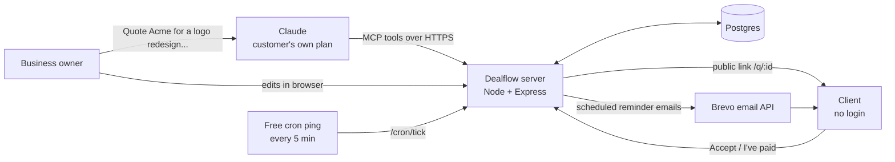

# Dealflow

**Tell Claude what you're charging. Dealflow gets you paid.**

Dealflow is a small business that runs on the customer's own Claude, with **no AI inside the app**.
A freelancer or small agency describes a job in Claude. Claude writes the quote (scope, line items, terms) and
sends it to Dealflow over MCP. Dealflow hosts it at a public link the client can accept in one click, turns the
accepted quote into an invoice, and sends Claude-written payment reminders on schedule until the invoice is paid.

| | |
|---|---|
| Live app | https://dealflow-2vnc.onrender.com |
| Test login | `demo@dealflow.app` / `demo1234` |
| MCP connector URL (test account) | `https://dealflow-2vnc.onrender.com/mcp/demo-volopay-7Qx2pLk9` (your own account's URL is on the **Connect Claude** page) |

## Submission documents

[Strategy (2 pages)](docs/Dealflow_Strategy.pdf) · [Architecture & implementation notes](docs/Dealflow_Architecture.pdf) ·
[Economics model](docs/Dealflow_Economics.xlsx) · [Video script](docs/VIDEO_SCRIPT.md) · [Submission checklist](docs/SUBMISSION.md)

## How it works



1. **Claude writes.** The owner asks Claude for a quote. Claude calls `create_quote` with the content it wrote.
2. **Dealflow stores and shows it.** The quote appears on the owner's dashboard, where every field can be edited.
3. **The client acts.** The owner shares the public link (or Claude calls `send_quote`). The client opens it
   (tracked), accepts with their name (recorded with a timestamp), and the quote becomes invoice `INV-000N` with the
   owner's payment instructions. The client can click **I've paid** with a payment reference.
4. **Dealflow follows up.** Claude writes a reminder sequence with `schedule_reminders`. Dealflow's scheduler emails
   each one when it's due, and cancels the rest the moment the invoice is marked paid or the quote is declined.
5. **Claude reads it back.** "What's unpaid? Has Acme opened it?" uses `list_quotes` / `get_quote`.

## MCP tools

| Tool | What it does |
|---|---|
| `get_business_profile` | Sender details, default currency, payment instructions, quote counts |
| `create_quote` | Create a quote from Claude's title, scope, line items, tax, discount, payment terms and T&Cs. Returns client and edit links |
| `list_quotes` | List quotes/invoices, filterable (`unpaid`, `accepted`, `paid`...), with open/accept status |
| `get_quote` | Full detail, reminders and activity log for one quote |
| `update_quote` | Change any field (items are replaced as a whole) |
| `send_quote` | Email the client the link (message optionally written by Claude) |
| `schedule_reminders` | Add Claude-written reminder emails at relative or absolute times. Supports `{{client_name}}`, `{{amount}}`, `{{number}}`, `{{due_date}}`, `{{link}}`, `{{sender_name}}` |
| `mark_paid` | Mark paid and cancel pending reminders |

Transport: Streamable HTTP, stateless (`POST /mcp/:key`). Each account has its own secret connector URL; the key
in the path identifies the account (no OAuth in v1).

## Connect it to Claude

1. Log in to Dealflow and open **Connect Claude**. Copy your connector URL.
2. In Claude (claude.ai or the desktop app): **Settings → Connectors → Add custom connector**. Name it
   `Dealflow`, paste the URL, leave OAuth fields empty, click **Add**.
3. In a new chat, make sure Dealflow is enabled in the tools menu, then ask:
   > Create a Dealflow quote for Priya at Acme Corp (priya@acme.com): logo redesign with 3 concepts and 2 revision
   > rounds for ₹40,000, plus brand guidelines for ₹15,000. 18% GST, 50% upfront. Then schedule 3 reminders:
   > friendly in 3 days, follow-up in 7, firm in 14.

Claude Code: `claude mcp add --transport http dealflow <connector URL>`

## What we built vs. what is proposed

| Built and live in v1 | Simulated / manual in v1 | Proposed next |
|---|---|---|
| MCP server with 8 tools | **Payment** is not processed: the invoice shows the owner's payment instructions (UPI/bank) and the client clicks "I've paid"; the owner confirms | Razorpay/Stripe payment links with automatic "paid" on webhook |
| Owner dashboard: edit every field, line items, reminders, activity log | **Email** goes out only if a Brevo key is configured; otherwise reminders are recorded in the app as "recorded, email off" | WhatsApp reminders (very common in India) |
| Public client page: view tracking, accept with name + timestamp, decline with reason, "I've paid", print to PDF | The demo account's payment details are samples | OAuth for the MCP connector instead of a secret URL |
| Quote → invoice conversion with separate numbering | | Recurring retainers, multi-currency reporting, GST-compliant invoice PDF |
| Scheduled reminders that stop on payment/decline | | Team seats, client portal across all their invoices |

## Our app vs. partner responsibilities

| Dealflow (this repo) | Partners |
|---|---|
| Accounts, data storage, quote/invoice logic and numbering, editing UI, public client pages, view/accept/paid tracking, reminder scheduling and cancellation, MCP tool definitions | **Claude (Anthropic, paid by the customer's plan):** all writing and reasoning: scope, pricing structure, terms, reminder copy, summaries. **Render:** hosting + Postgres. **Brevo:** email delivery. **cron-job.org:** 5-minute wake-up ping. |

No AI provider keys exist anywhere in the code or config.

## Tech

Node 20+, Express 5, `@modelcontextprotocol/sdk` (Streamable HTTP), Postgres (`pg`), server-rendered HTML with a
little vanilla JS. No frontend framework and no build step.

```
src/server.js     routes: marketing, auth, owner app, public client pages, /mcp/:key, /cron/tick
src/mcp.js        MCP server and the 8 tools
src/quotes.js     domain logic: totals, numbering, status changes, reminders, template placeholders
src/reminders.js  scheduler and email delivery (Brevo API, or in-app log)
src/views.js      HTML pages
src/db.js         Postgres pool and schema (auto-migrates on boot)
src/auth.js       password hashing (scrypt), signed session cookies, demo account
```

Statuses: `draft → sent → viewed → accepted (invoice, awaiting payment) → paid`, or `declined`.

## Run locally

```bash
npm install
cp .env.example .env   # set DATABASE_URL to any Postgres
export $(grep -v '^#' .env | xargs) && npm start
```

Open http://localhost:3000 and log in with the demo account.

## Deploy (Render, free)

1. On [render.com](https://render.com), **New → Blueprint**, pick this repository. `render.yaml` creates the web
   service and a free Postgres database, and generates the secrets.
2. Optional, for real emails: create a free [Brevo](https://brevo.com) account, verify a sender address, create an
   API key, and set `BREVO_API_KEY` and `SENDER_EMAIL` on the service.
3. Optional, recommended: on [cron-job.org](https://cron-job.org) create a job that calls
   `https://<your-app>.onrender.com/cron/tick?secret=<CRON_SECRET>` every 5 minutes. This sends due reminders and
   keeps the free instance awake so Claude never hits a cold start.

Environment variables: `DATABASE_URL`, `SESSION_SECRET`, `PUBLIC_URL` (optional; Render's URL is detected
automatically), `DEMO_EMAIL`, `DEMO_PASSWORD`, `DEMO_MCP_KEY`, `BREVO_API_KEY`, `SENDER_EMAIL`, `CRON_SECRET`.

## Assumptions and limitations

- Free Render instances sleep after 15 minutes idle; the cron ping prevents this. Render's free Postgres expires
  after 30 days. Move to a paid plan or Neon for anything longer.
- The connector URL is a bearer secret. Anyone with it can act on that account; it can be reset from the Connect page
  (except on the shared demo account, which is pinned so reviewers can use it).
- Amounts are stored per quote in that quote's currency; dashboards don't convert currencies.
- One owner per account; no team roles yet.
